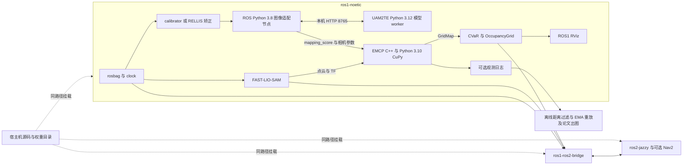

# UAM2TE 推理与风险建图部署说明

记录日期：2026-10-30。适用主机：425server，工程根目录 `/mnt/nvme1n1/whd`。

当前已验证的实验流程为 **ROS1 bag → FAST-LIO-SAM 与相机矫正 → 图像推理 → EMCP 世界栅格 EMA → CVaR 代价地图 → RViz / 文件导出**。整条流程在 `ros1-noetic` 内运行，项目源码直接挂载宿主机。ROS2 Jazzy 与 bridge 用于后续接入 Nav2，当前论文建图实验不依赖它们。Nav2 已安装，尚未完成机器人导航闭环验收。

本文记录已经分组提交的部署实现。各仓库必须使用配套版本，第 12 节给出本次版本；第 10 节保留提交前审计，便于理解改动来源与仍存在的本机依赖。按实验日期整理的历史过程继续保留在 [README.md](README.md)，本文作为当前部署入口。

## 1 容器与数据流



| 容器 | 镜像及依赖来源 | 当前职责 |
| --- | --- | --- |
| `ros1-noetic` | `robotics/noetic-cuda:20261028`；基于 `emcupy:blackwell-20261026`，从 `rellis-builder-runtime:20261027` 引入 GTSAM | bag、SLAM、矫正、模型 worker、ROS 适配、EMCP、CVaR、RViz |
| `ros2-jazzy` | `robotics/jazzy-cuda:20261028`；`osrf/ros:jazzy-desktop-full` 加 CUDA 12.8.1 | ROS2、Nav2；具备 Torch / CuPy 环境 |
| `ros1-ros2-bridge` | `robotics/bridge-jazzy:20261028`；Ubuntu 24.04 中的 Jazzy 和 Noetic PPA | 消息转换，不承担模型推理，无 GPU 依赖 |
| `torch`、`emcupy`、`rellis-builder-20261027` | 以前的训练、建图与数据制作环境 | 仍存在，但不是当前统一部署流程必须启动的容器；不要因整理部署而删除 |

三个新容器均为 `network_mode: host`、`ipc: host`。宿主机 `/mnt/nvme1n1/whd` 同路径可写挂载，`/mnt/sda/datasets` 只读挂载；X11 使用 `/tmp/.X11-unix`，当前显示为 `DISPLAY=:1`。uv Python 解释器目录 `/home/whd/.local/share/uv/python` 也只读挂载，以支持宿主机 `.venv`。

容器启动默认仅执行 `sleep infinity`。**容器处于 Up 状态，不代表 ROS Master、bridge 或 Nav2 已经启动。** 本次核对时三个容器均运行；最后的 CVaR 会话记录已标记 `stopped=true`。

### Python 环境分工

| 组件 | 解释器 | 原因 |
| --- | --- | --- |
| ROS 图像适配、矫正、CVaR 导出 | Noetic 的 `/usr/bin/python3`，Python 3.8 | 匹配 `rospy` / `cv_bridge` 的 ABI |
| EMCP C++ 内嵌 Python | `/opt/emcupy-py310/bin/python`，Python 3.10，CuPy 13.6 | GPU 建图与 pybind |
| 当前模型 worker | `/mnt/nvme1n1/whd/uam2te/.venv/bin/python`，Python 3.12，Torch 2.10.0+cu128 | 使用模型已有依赖，通过 HTTP 与 ROS 隔离 |
| Jazzy GPU 环境 | `/opt/gpu/bin/python`，Python 3.12 | Torch 2.10 cu128 / CuPy；Nav2 本身不依赖本模型 |

Noetic 镜像中另有 Python 3.10 / Torch 2.7.1 cu128 环境，但当前模型 worker 实际使用的是挂载的 Python 3.12 `.venv`。不要把 Noetic 的系统 Python 全部替换为模型 Python。

## 2 源码与工作空间

| 项目 | 实际宿主机位置 | 关键入口 |
| --- | --- | --- |
| 部署编排 | `/mnt/nvme1n1/whd/ros-jazzy-ros1-bridge-builder` | `runtime/compose.yaml`、`runtime/cvar_session.py`、`runtime/env.sh` |
| UAM2TE | `/mnt/nvme1n1/whd/uam2te` | `scripts/serve_navigation_inference.py`、`uam2te/speed_curve_deployment.py` |
| ROS 推理包 `uam2te_msgs` | `/mnt/nvme1n1/whd/uam2te/scripts/ros_workspace/src/ros_interface` | `scripts/navigation_inference.py`、`launch/navigation.launch` |
| EMCP Git 仓库 | `/mnt/nvme1n1/whd/emcp/src/elevation_mapping_cupy` | `elevation_mapping_cupy/launch/navigation.launch`、`script/generate_risk_costmap.py`（后者相对包目录） |
| FAST-LIO-SAM Git 仓库 | `/mnt/nvme1n1/whd/stepp_adapter/third_party/FAST_LIO_SAM` | 包在其 `FAST_LIO_SAM/` 子目录；`mapping_rs_bistu.launch` / `mapping_rellis3d.launch` |
| 相机矫正 | `/mnt/nvme1n1/whd/calibrator` | `launch/camera_rect_ros_mono.launch` |
| 数据集制作 | `/mnt/nvme1n1/whd/traversability_dataset_builder` | 编译进入工作空间；本次推理建图无需在线制作训练数据 |

`/mnt/nvme1n1/whd/FAST_LIO_SAM` 是指向上述实际仓库的入口；不要把它和 `rellis_builder_runs/*/ws/src` 下的实验副本混为一谈。`/mnt/nvme1n1/whd/emcp` 是工作空间根目录，Git 提交应在其 `src/elevation_mapping_cupy` 内进行。

编译产物统一放在部署仓库的 `.runtime/`：

- `.runtime/noetic/src/` 使用符号链接关联上述宿主机源码，`build/`、`devel/` 是 Noetic 专用产物。
- `.runtime/messages-ros1` 与 `.runtime/messages-ros2` 编译 `custom_msgs/` 中的桥接消息。
- `.runtime/bridge` 编译固定版本的 `ros1_bridge`。bridge 容器内的 Noetic 消息产物属于 Ubuntu 24.04，不能给 Ubuntu 20.04 的 Noetic 容器作 overlay。
- Livox 编译依赖目前链接到 `/mnt/nvme1n1/whd/rellis_builder_runs/20261027/ws/src/livox_ros_driver2`。这个目录不是独立 Git 仓库，迁移主机时必须另行提供。

Python 源码修改后重启相关进程即可；C++、消息定义或编译配置改变后需要重编译。不要直接修改 `.runtime/noetic/src` 中链接所指的另一个实验副本。

## 3 当前模型与建图规则

配置与权重：

```text
/mnt/nvme1n1/whd/uam2te/configs/experiments/speed_response/tasks_20261020/curve_app_s_s42_20261020.yaml
/mnt/nvme1n1/whd/uam2te/checkpoints/speed_curve_matrix_20261020/curve_app_s_s42_20261020/20261021-015701_curve_app_s_s42_20261020_best-epoch-001-valid_curve_normalized_mae-0.0578.ckpt
checkpoint SHA256: cdff1834337f7522fe85e57d8cb4d30ed188065bb043750280fc7b9bf6fe739d
```

worker 接口：`GET /metadata`、`POST /infer`、`POST /infer_speeds`，监听 `127.0.0.1:8765`。请求是 uint8 BGR 图像的 NPY 字节；响应是浮点数组的 NPZ 字节。ROS 节点检查尺寸、有效值、模型身份与速度配置。

单张图像预测整组速度锚点，再在 logit 空间查询指定速度，输出预测分数 `τ̂(v)`、support `ŝ(v)`、乘积 `q(v)=τ̂(v)ŝ(v)`，以及诊断代价 `1-q`。三速度共用一次图像前向。当前锚点范围约为 0.18525–1.56943 m/s；查询速度必须在范围内。参考速度是模型条件，不会改变 bag 中车辆的真实运动速度。

BISTU 原图经 calibrator 去畸变及裁切，当前矫正图为 1920×1440；模型预处理尺寸为 448×336，再进入模型内部填充网格。**q 在模型原生网格先相乘，再去填充并恢复原图尺寸**，不能改为两个放大后的图相乘。图像、CameraInfo 与 TF 必须使用对应矫正几何和图像采集时间戳。

| 参数 | 已确定的实验值 | 含义 |
| --- | --- | --- |
| support 门槛 | 0.15 | 低于门槛的观测变为 NaN，跳过更新；不是赋值为 0 |
| EMA `γ` | 0.2 | 新观测权重；按有效观测次数更新，不是按墙钟时间衰减 |
| CVaR `α` | 通常 0.95；对照 0.05 | 对时间融合分数的低尾风险进行保守估计 |
| 栅格分辨率 | 0.5 m | BISTU 默认 200×200 m 世界范围，400×400 格 |
| 分档阈值 | 0.20 / 0.35 / 0.50 / 0.65 | 对应代价 100 / 70 / 50 / 30 / 0，未知为 -1 |
| 距离限制 | 按实验选择 3 / 6 / 8 m | 目前在离线观测重放中执行，不是在线 launch 参数 |

对于同一个世界格，初次观测设 `μ=q, variance=0, count=1`；随后：

```text
μ_new        = 0.8 μ_old + 0.2 q
variance_new = 0.8 variance_old + 0.2 (q - μ_new)²
lower_score  = μ - k(α) sqrt(variance)
k(0.95)      ≈ 2.0627128
```

这里使用更新后的均值计算残差，不是无偏样本方差。每个速度有独立状态；世界格历史不随局部高程窗口移走而清除。未通过 support 或距离门槛的观测不增加 count，已有格保留历史。代价分档发生在融合与 CVaR 之后，网络诊断图 `1-q` 不是最终地图代价。

### 在线与离线的边界

- support 门槛与可选时间窗口在线执行；窗口仅控制 `/uam2te/mapping_score` 发布，完整 bag、SLAM 和网络诊断输出继续运行。
- 距离限制依据每次图像采集时的 `base_link` 位姿，计算世界格中心的水平距离，在该次 EMA 更新前过滤；不是裁切最终地图。
- 三速度在线 EMCP 融合全部通道，但默认 GridMap/CVaR 显示和网络诊断只展示第一速度。完整三速度论文图由观测日志重放导出。
- `cvar_session.py` 默认同时启动 α=0.95 和 α=0.05 两个导出器；没有 `--alpha` 启动选项，单独选 α 是导出阶段的选项。

## 4 构建与启动

### 已有镜像的日常使用

宿主机执行，以下公共变量也用于后续示例：

```bash
cd /mnt/nvme1n1/whd/ros-jazzy-ros1-bridge-builder
docker compose -f runtime/compose.yaml up -d

model_cfg=/mnt/nvme1n1/whd/uam2te/configs/experiments/speed_response/tasks_20261020/curve_app_s_s42_20261020.yaml
model_ckpt=/mnt/nvme1n1/whd/uam2te/checkpoints/speed_curve_matrix_20261020/curve_app_s_s42_20261020/20261021-015701_curve_app_s_s42_20261020_best-epoch-001-valid_curve_normalized_mae-0.0578.ckpt
bag_file=/mnt/sda/datasets/whd/bunker/UNUSED_ROSBAG_25/2025-06-27-14-30-04.bag
```

启动单速度实验：

```bash
python3 runtime/cvar_session.py start \
  --bag "$bag_file" --config "$model_cfg" --checkpoint "$model_ckpt" \
  --reference-speed 0.8 --display :1 --play-rate 0.2 \
  --support-min 0.15 --ema-gamma 0.2 --resolution 0.5 \
  --cost-encoding five_level --cost-thresholds 0.2 0.35 0.5 0.65 \
  --record-ema
```

这个命令依次启动 Master、worker、SLAM/矫正/建图、记录与可视化节点、两个 RViz，最后自动解除 bag 暂停。ROS Master 使用 11671，worker 使用 8765，两端口须空闲。0.2 是 bag 回放倍率，0.8 才是模型参考速度。论文完整采样沿用慢速回放；实时性能测试使用 1×、关闭可视化及观测写盘，不能混用两种 FPS 口径。

```bash
python3 runtime/cvar_session.py status
python3 runtime/cvar_session.py pause
python3 runtime/cvar_session.py resume
python3 runtime/cvar_session.py save
python3 runtime/cvar_session.py stop
```

回放结束后观察节点自动保存并保留最终 RViz 场景。`status` 读取保存的状态，可能反映已结束的会话，不是实时进程存活证明。`stop` 依据 PID 和启动时间清理本会话进程，不关闭容器。再次实验先 `stop` 再 `start`，不要只重播 bag 继续累积旧 EMA。最后一次会话路径记录在 `.runtime/cvar_active.json`。

### 三速度与时间窗口

停止前一会话后，仍使用上面的公共变量：

```bash
python3 runtime/cvar_session.py start \
  --bag "$bag_file" --config "$model_cfg" --checkpoint "$model_ckpt" \
  --reference-speeds 0.4 0.9 1.4 --display :1 --play-rate 0.2 \
  --support-min 0.15 --ema-gamma 0.2 --resolution 0.5 \
  --cost-encoding five_level --cost-thresholds 0.2 0.35 0.5 0.65 \
  --record-ema
```

只融合 bag 起点后 20–30 秒时，给该 `start` 命令增加 `--mapping-window 20 30`。窗口为 `[20,30)`，依据图像采集时间戳，回放和 SLAM 仍覆盖整个 bag。控制器自动换算为绝对时间；不要向通用 ROS launch 的 `mapping_window` 直接填相对秒数。三速度模式自动启用 EMA 观测记录，目前限 BISTU 平台。

点云入口存在历史差异：BISTU 单速度默认 `/cloud_registered`，BISTU 三速度及 RELLIS 使用 `/cloud_registered_body`。后者保留移动传感器原点，对 EMCP 的高度/距离筛选重要。此前耗时测试显式让单、三速度均使用 body 点云，不能据此声称默认单速度 launch 也已切换。比较两条入口的建图结果时必须核对 `session.json` 中的 `pointcloud_topic`。

### 初次构建或源码更新

```bash
cd /mnt/nvme1n1/whd/ros-jazzy-ros1-bridge-builder
git submodule update --init --recursive
bash runtime/prepare_bridge_source.sh
docker compose -f runtime/compose.yaml build
docker compose -f runtime/compose.yaml up -d
docker exec ros1-noetic bash /mnt/nvme1n1/whd/ros-jazzy-ros1-bridge-builder/runtime/build_noetic.sh
docker exec ros1-ros2-bridge bash /mnt/nvme1n1/whd/ros-jazzy-ros1-bridge-builder/runtime/build_bridge.sh
```

此处假设第 2 节源码及依赖目录齐全。换机器还需要迁移或重建本机基础镜像、模型 `.venv`、uv 解释器、checkpoint、Livox 依赖及序列标定。`images.lock.json` 记录镜像 ID；当前 Dockerfile 使用 tag，并未通过 digest 强制锁定所有基础镜像。Jazzy 构建还读取宿主机 `.venv` 的 site-packages 快照，不能仅凭 Dockerfile 认为全新机器可独立构建。

`bash runtime/enter.sh noetic`、`jazzy`、`bridge` 打开相应终端。脚本内使用 `source runtime/env.sh noetic [gpu]` 等命令设置环境；模型入口 `runtime/run_model.sh` 最终调用挂载 `.venv` 中的 `scripts/serve_navigation_inference.py`。

## 5 6 m 限制与论文图导出

在线启动时需要 `--record-ema`。**当前控制器不会自动建立 BISTU 的 `calibration_used/` 快照**；以前的实验是额外归档的。新实验应在 `start` 返回后立即执行下列归档，且启动到归档期间不修改标定文件。历史会话使用其当时保存的快照，不能用今天的标定冒充历史版本。

```bash
cd /mnt/nvme1n1/whd/ros-jazzy-ros1-bridge-builder
session_dir=$(python3 -c 'import json; print(json.load(open(".runtime/cvar_active.json"))["output"])')
mkdir -p "$session_dir/calibration_used"
cp -n /mnt/nvme1n1/whd/stepp_adapter/third_party/FAST_LIO_SAM/FAST_LIO_SAM/launch/mapping_rs_bistu.launch "$session_dir/calibration_used/"
cp -n /mnt/nvme1n1/whd/stepp_adapter/third_party/FAST_LIO_SAM/FAST_LIO_SAM/config/helios_bistu.yaml "$session_dir/calibration_used/"
cp -n /mnt/nvme1n1/whd/calibrator/launch/camera_rect_ros_mono.launch "$session_dir/calibration_used/"
```

其中 `mapping_rs_bistu.launch` 是距离重放读取外参的必需文件，另外两份记录对应 SLAM 与矫正配置。等待完整回放完成、会话目录产生 `result.json` 后，再运行导出。单速度、全 bag、α=0.95、6 m：

```bash
/mnt/nvme1n1/whd/uam2te/.venv/bin/python runtime/materialize_range_maps.py "$session_dir" \
  --max-range-m 6 --alpha 0.95 \
  --output /mnt/nvme1n1/whd/cvar_results/june27_v08_range6m_new
```

三速度、6 m，时间窗口沿用来源会话设置：

```bash
/mnt/nvme1n1/whd/uam2te/.venv/bin/python runtime/materialize_speed_maps.py "$session_dir" \
  --max-range-m 6 \
  --output /mnt/nvme1n1/whd/cvar_results/june27_three_speeds_range6m_new
```

两条命令分别要求来源是单速度/三速度会话，不能对同一来源混用。输出目录必须为空；再次导出换一个目录名。当前距离工具读取 BISTU 保存的 `calibration_used/mapping_rs_bistu.launch`，不能直接套用于 RELLIS；单速度距离工具目前要求全 bag，不接受时间窗口。三速度成图工具要求既定的 EMA=0.2、support=0.15、0.5 m 分辨率。

输出包括 300 dpi PNG、PDF、带轨迹及无轨迹版本、融合统计和审计记录。未限制距离的世界地图先用 `compare_ema.py SESSION --gammas 0.2` 重建，再用 `export_cvar_figure.py SESSION --output DIR --alpha 0.95 --dpi 300` 导出。周期 GridMap / OccupancyGrid 保存值和完整逐观测世界重放不是同一输出口径；论文图应保留来源及导出参数。

## 6 RELLIS 入口

已使用的序列对应关系：`00001 → 20200213_trail_1.bag`；`00003 → 20200213_trail_1_r.bag`。每个序列使用自己的 `calibration.json` 和 `camera.launch`。

例如 00001 单速度实验，复用第 4 节模型变量：

```bash
python3 runtime/cvar_session.py start --platform rellis \
  --bag /mnt/sda/datasets/OpenAccess/RELLIS-3D/Full-stack-Merged-data/20200213_trail_1.bag \
  --calibration-dir /mnt/nvme1n1/whd/ros-jazzy-ros1-bridge-builder/.runtime/rellis_00001_cvar_preflight/calibration \
  --config "$model_cfg" --checkpoint "$model_ckpt" \
  --reference-speed 0.8 --map-length 400 --origin-x -50 --origin-y -200 \
  --play-rate 0.2 --record-ema --display :1
```

00003 改用 `20200213_trail_1_r.bag` 和 `.runtime/rellis_00003_cvar_preflight/calibration`。这些标定目录是本机实验产物，迁移时要单独保存；不是控制器自动下载生成的。

控制器调用 `mapping_rellis3d.launch`，只回放 Pylon 图像/CameraInfo、Ouster 点云/IMU。`rellis_camera.py` 输出 `/uam2te/rellis/image_rect` 及匹配 CameraInfo。独立 SLAM 的全局帧是 `camera_init`；实验 launch 额外发布恒等的 `map → camera_init`。不要同时回放 bag 自带的冲突 TF。

## 7 话题与可选 ROS2 通信

| 数据 | 话题 | 使用方 |
| --- | --- | --- |
| BISTU 原始传感器 | `/hikrobot_camera_L/image_raw`、`/rslidar_points`、`/imu/data` | 矫正与 SLAM |
| BISTU 矫正输入 | `/hikrobot_camera_L/image_rect`、`/hikrobot_camera_L/image_rect/camera_info` | ROS 推理适配 |
| SLAM | `/Odometry`、`/path`、`/cloud_registered_body`、TF | 建图与轨迹记录 |
| 原始预测 q | `/uam2te/conservative_score` | 诊断；三速度时仅第一速度 |
| 建图输入 | `/uam2te/mapping_score` | support 掩码及时间门控后，单速度 32FC1 / 三速度 32FC3 |
| 投影元数据 | `/uam2te/prediction_camera_info`、`/uam2te/channel_info` | EMCP |
| 网络分数/support | `/uam2te/score`、`/uam2te/support` | 数值诊断 |
| EMCP | `/navigation_elevation/filtered_elevation_map` | CVaR 导出；配置发布 3 Hz |
| 代价图 | `/similarity_costmap`、`/similarity_costmap_alpha_005` | ROS1 RViz；前者默认桥接 |
| 热图和叠加 | `/uam2te/visualization/q_heatmap`、`q_overlay`、`support_heatmap` 等同前缀话题 | `network_visualizer.py` 与 RViz |

仅当使用 ROS2 消费者时，在 ROS1 Master 启动后启动 bridge：

```bash
docker exec -it ros1-ros2-bridge bash /mnt/nvme1n1/whd/ros-jazzy-ros1-bridge-builder/runtime/run_bridge.sh
```

`runtime/topics.yaml` 白名单为 `/clock`、`/tf`、`/tf_static`、`/Odometry`、`/similarity_costmap`、`/cmd_vel`。当前 `parameter_bridge` 对白名单话题建立双向转换，不代表强制单向路由。原图、原始点云和 GridMap 默认不跨桥，避免不必要的高带宽转换。host IPC 不会把 ROS1/ROS2 类型转换变成零拷贝。

连接参数：`ROS_MASTER_URI=http://127.0.0.1:11671`，`ROS_IP=127.0.0.1`，DDS domain=71，Fast DDS，发现范围 LOCALHOST。接真实局域网机器人时需要统一修改这些地址与发现范围。

Nav2 可通过 StaticLayer 订阅 `/similarity_costmap`，配置 `map_subscribe_transient_local: true`、`trinary_costmap: false`，保留未知区语义。机器人 footprint、障碍物层、膨胀层、控制器及完整 TF 链仍需具体机器人配置；本仓库目前没有一条已经验收的完整 Nav2 导航启动命令。

### UDP 参数的实际状态

2026-10-30 读取宿主机值仍为：`net.core.rmem_max=212992`、`net.core.wmem_max=212992`、`net.ipv4.ipfrag_high_thresh=4194304`、`net.ipv4.ipfrag_time=30`。**优化建议尚未应用。**

`runtime/fastdds.xml` 请求 16 MiB socket 缓冲；`runtime/network.conf` 建议上限 64 MiB、分片重组 128 MiB、超时 3 s。`python3 runtime/tune_network.py` 只检查；管理员可按现有 README 的 apply/restore 流程调整。当前推理 worker 的本机 HTTP / ROS1 数据处理瓶颈不应直接归因于 DDS UDP 参数。

## 8 日志与结果位置

| 位置 | 内容 | 保存策略 |
| --- | --- | --- |
| 部署仓库 `.runtime/cvar_日期_时间/` | 启动参数、worker 身份、进程记录、SLAM/ROS 日志、相机样例、轨迹、EMA trace、统计和 RViz 配置 | 被 Git 忽略，实验复现需要单独归档 |
| `.runtime/cvar_active.json` | 最后会话定位及 stopped 标记 | 运行记录，不提交 |
| `/mnt/nvme1n1/whd/cvar_results/` | 论文 PNG/PDF、CSV/NPZ、审计、来源快照、ZIP | 工程根目录下的独立结果，单独备份 |
| `uam2te/checkpoints/`、`uam2te/.venv/` | 权重与 Python 依赖 | 不作为普通代码提交；记录哈希和环境版本 |
| `runtime/` | 可复用部署源码、Dockerfile、参数、工具与说明 | 应纳入版本控制，不能与 `.runtime/` 混淆 |

`--record-ema` 会逐观测同步取回并压缩写盘，适合可审计实验，会影响性能。耗时统计另见下一节。

## 9 已完成的性能测量

结果目录：`/mnt/nvme1n1/whd/cvar_results/2025-06-27-14-30-04_deployment_timing_20261030/`。使用 June 27 bag、1×、SLAM 并行，关闭 RViz 和 EMA trace；无在线 6 m 过滤。单速度 / 三速度平均耗时分别为：网络前向 17.3 / 16.8 ms，完整推理回调 187.6 / 312.3 ms，图像建图回调 17.7 / 76.2 ms。单速度原始部署为 5.28 FPS；计时版 5.01 FPS，三速度计时版 3.05 FPS。

`runtime/profiling/` 为可选插桩，C++ 由 `UAM2TE_PROFILE_DIR` 控制；生产启动不会自动开启。详细 CSV、测量边界、P95 和原始日志都在结果目录。当前 `profiling/run_bag.py` 固定依赖 `.runtime/cvar_20261029_103551/session.json` 和已保存的预热图，不是任意 bag 的通用命令。改变输入前应先参数化，不要只改输出目录就声称测了另一个 bag。

## 10 提交前 Git 分析

以下是编写文档时、用户授权提交之前的快照；范围为部署及其直接依赖仓库，不包含所有训练 worktree。该审计时刻所有仓库暂存区均为空。此后按第 12 节完成分组提交，表中未提交数量不代表当前状态。

| 仓库 | 分支与 HEAD | 已跟踪修改 | 未跟踪文件 | 主要内容 |
| --- | --- | ---: | ---: | --- |
| UAM2TE | `self-supervised-2609` / `d410483` | 7 | 1 | 三速度、support 与时间门控、部署兼容、测试 |
| EMCP | `main` / `00926cb` | 9 | 1 | 五档代价、trace/位姿记录、可选计时、测试 |
| 部署仓库 | `main` / `4b89826` | 2 | 52 | `.gitignore`、README，以及整个 `runtime/` |
| FAST-LIO-SAM | `master` / `4a44c15` | 1 | 8 | STONE 适配相关 README、配置、launch、工具，与本次建图主线分开 |
| calibrator | `73c6edb` | 0 | 0 | 干净 |
| traversability_dataset_builder | `main` / `6dc8ed7` | 0 | 0 | 干净 |
| custom_msgs | `d41b98c` | 0 | 0 | 干净的子模块 |
| ros1_bridge | `8f1b7e9` | 0 | 0 | 干净的独立 checkout，由固定版本脚本准备，在父仓库忽略 |

快照与 tracked diff 位于部署仓库 `.runtime/deployment_doc_audit_20261030/`。本次新增 `runtime/DEPLOYMENT.md`，并为两个 README 添加入口，因此文档完成后部署仓库的未跟踪文件增加为 53；这不代表新改了 53 个功能文件。

### 10.1 UAM2TE 改动

- `uam2te/speed_curve_deployment.py` 与 `scripts/serve_navigation_inference.py`：增加 `infer_many`、`/infer_speeds`、速度列表验证；共享一次网络前向，按需恢复输出字段。
- `scripts/ros_workspace/src/ros_interface/scripts/navigation_inference.py`：新增 `/uam2te/mapping_score`，support<门槛变 NaN；按图像时间戳进行 `[start,end)` 门控；三通道发布及可选审计。
- 同目录 `launch/navigation.launch`、`readme.md`：使用矫正图/CameraInfo，传递多速度、门槛、时间窗、trace、分辨率和分档参数。
- `uam2te/models/traversability_net.py`：PointPillars 改为实际启用该编码器时才导入，避免纯图像推理加载不兼容的原生扩展；不是训练权重修改。
- `tests/test_speed_curve_deployment.py` 与尚未跟踪的 `tests/test_navigation_mapping_window.py`：覆盖多速度共享前向、q 乘法顺序和时间窗/NaN 门控。

### 10.2 EMCP 改动

- `risk_mapping.py` 与 `generate_risk_costmap.py`：新增五档编码及阈值验证，保留连续编码，导出时记录阈值和 support 门槛。
- `image_ema_variance.py`、`parameter.py`、`semantic_map.py`、`elevation_mapping.py`：可选逐观测 trace，记录图像时刻 TF、候选投影和 posterior，支持离线距离/速度重放。核心 EMA 递推已在 HEAD 中，本次 diff 没有把它换成另一种公式。
- `launch/navigation.launch`：支持建图输入话题、多个语义通道、融合器配置及 trace/分档参数。
- `elevation_mapping_ros.cpp` 与未跟踪的 `include/elevation_mapping_cupy/runtime_timing.hpp`：环境变量控制的单调时钟计时。
- `tools/rellis_runtime/test_navigation_risk.py`：五档边界、未知区、trace、持久世界状态与 CVaR 导出验证。

### 10.3 需要注意的问题

以下保留提交前发现：第 1、2 项已随本次提交解决，其余接口配套、默认值和本机依赖要求仍适用。

1. **部署脚本尚未入 Git。** `git diff --stat` 仅显示 tracked 文件，会漏掉 52 个 runtime 文件；`git add -u` 同样不会加入它们。只提交 README 不能交付可运行部署。
2. **C++ 新头文件必须和调用方一起提交。** 只提交 `elevation_mapping_ros.cpp`、遗漏 `runtime_timing.hpp`，全新检出后会因 include 缺失而编译失败。UAM2TE 新时间窗测试也不能遗漏。
3. **跨仓库接口需要成组发布。** 新 UAM2TE launch 传给 EMCP 的 `score_topic`、`score_channels`、`score_fusions`、`ema_trace_dir`、`cost_encoding` 等参数，在旧 EMCP HEAD 中不存在。不能仅更新 UAM2TE 后继续使用旧 EMCP launch。
4. **通用 launch 与实验默认值不同。** 通用 UAM2TE/EMCP 入口仍默认 0.1 m、连续代价、alpha=0.9，UAM2TE support 默认为 0；最终实验通过控制器明确传入 0.5 m、五档、alpha=0.95 和 support=0.15。直接启动通用入口时必须显式传参。
5. **距离导出缺少自动标定归档。** 两个距离重放工具读取 `calibration_used/mapping_rs_bistu.launch`，而 `cvar_session.py` / 观察器不会自动保存它。新会话仅运行 start 后直接导出会缺文件；第 5 节补充了手工归档。后续可把启动时保存标定纳入控制器。
6. **有本机依赖，不能宣称完全可迁移。** 基础镜像、`.venv`、uv 解释器、未受 Git 管理的 Livox 目录、RELLIS 标定与性能脚本固定会话均需打包/参数化。`images.lock.json` 是记录，当前不是完整依赖重建系统。
7. **性能与发布行为有实验用途限制。** 三速度默认只在线导出第一速度；trace 和时间窗审计写盘会增加耗时。6 m 过滤属于离线重放。它们不能不加说明地作为实时导航链路。

### 10.4 建议的提交分组

| 顺序 | 仓库 | 提交内容 |
| --- | --- | --- |
| 1 | UAM2TE | PointPillars 延迟导入，独立的部署兼容改动 |
| 2 | EMCP | 多通道配置、五档代价、trace/位姿记录及相关测试 |
| 3 | UAM2TE | 多速度 worker/适配、support/时间窗门控、launch、说明及测试；与上一步作为同一部署版本发布 |
| 4 | EMCP | 可选 C++ 计时及新头文件 |
| 5 | 部署仓库 | 容器、环境、构建与 bridge、会话/可视化、离线重放、测试及当前说明；先提交共同依赖再拆分实验工具 |
| 6 | 部署仓库 | `profiling/` 和 `profile_entry.py`，依赖上一步及 EMCP 计时接口 |
| 独立处理 | FAST-LIO-SAM | STONE 配置与分析工具，不混入本次推理建图发布 |

不要把 `.runtime/`、bag、权重、`.venv`、结果图片/NPZ、编译产物一并加入代码提交。FAST-LIO-SAM 的 STONE 工具属于另一条工作线，当前记录范围内未逐项验收，不据本次测试替它们背书。

## 11 本次核验

整理文档阶段仅新增/更新说明，没有改变推理或建图功能、没有重启实验。已有改动的针对性测试已实际运行：

- Noetic 容器内模型 `.venv`：`tests/test_speed_curve_deployment.py`，4 项通过。
- Noetic 系统 Python：`tests/test_navigation_mapping_window.py`，2 项通过，覆盖边界、延迟回调和三通道过滤。
- Noetic 内 Python 3.10 / GPU：`tools/rellis_runtime/test_navigation_risk.py`，6 项通过。

上述 12 项是当前改动的针对性检查，不等于全仓库或 Nav2 闭环验收。前一轮完整 bag 性能实验另已验证插桩输出与原始 worker 数组一致，源码快照与日志保存在第 9 节结果目录。

## 12 本次提交的配套版本

2026-10-30 按用户授权提交 UAM2TE、EMCP 和部署仓库，保持各自原分支。FAST-LIO-SAM 的 STONE 工作仍单独保留。

| 仓库 | 分支 | 本次配套版本 |
| --- | --- | --- |
| UAM2TE | `self-supervised-2609` | `a222b1f79b7ef982e5e109f5c6217029e37bc900`；包含兼容修复 `c2cf20c` |
| EMCP | `main` | `1cc3773ed45c02d2d4acc8e15fb45a994ff54b03`；包含建图与 trace 改动 `568be3c` |
| ros-jazzy-ros1-bridge-builder | `main` | 本文此次版本所在的提交，包含 runtime 部署、实验工具及 profiling |

在部署仓库用 `git log -1 --format=%H -- runtime/DEPLOYMENT.md` 获取本文此次版本的完整提交号。`images.lock.json` 中较早的源码 revision 是镜像构建时的历史记录，不代表本次挂载项目的源码版本。

提交前另核对了 runtime 中 Python、Shell、XML 语法及 ROS 可执行入口权限，`runtime/test_range_fusion.py` 的 2 项测试通过。连同上节 12 项共 14 项针对性测试通过。提交内容不包含 bag、checkpoint、`.venv`、`.runtime` 日志/编译产物或论文图像；第 5 节的手工标定归档和第 9 节性能脚本固定会话限制仍然存在。
